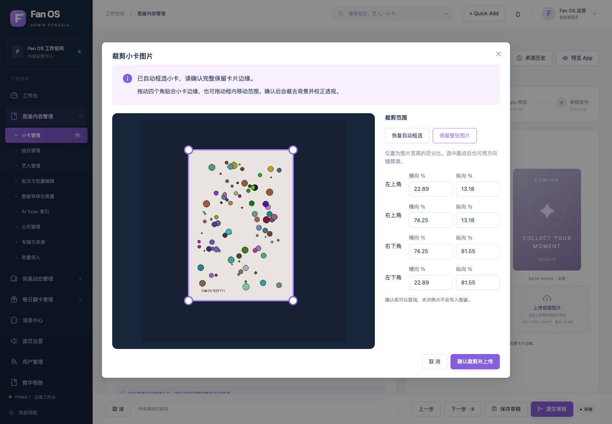

# 后台小卡自动裁剪与手动调整

更新日期：2026-10-11。

## 使用入口

- 小卡管理 →「上传识别」：先检测并调整卡片范围，点击「确认裁剪并识别」后，用裁剪后的图片查找已有记录；未匹配时带入新增表单。
- 小卡新增 / 编辑 → 基础信息或正反面图片：上传正面、背面或更换图片时，先进入同一裁剪窗口，点击「确认裁剪并上传」后带回表单。保存草稿后才更新小卡记录。

支持 JPG、PNG、WebP，单张最大 10 MB、4000 万像素。公司、组合、艺人及其他普通图片上传沿用原有流程。

## 裁剪操作

1. 自动检测照片中的卡片边界，背景区域变暗，保留范围内照片。
2. 拖动四个圆点贴合小卡四角，或拖动框内移动整个选区。四角可分别填写横向 / 纵向百分比；聚焦圆点后支持方向键微调，Shift + 方向键加大步长。
3. 可随时「恢复自动框选」或「保留整张图片」。检测到多张时，通过下拉框选择本次保留的一张；未检测到可靠边缘时保留全图并提示手动调整。
4. 确认后按四角裁去背景并校正倾斜透视，长边最多 5000 像素。最终处理使用校正手机照片方向后的原图，预览缩小不会降低最终裁剪质量。

不允许交叉、重合、越界或过小选区。自动检测属于候选范围，应确认是否完整保留卡片边缘。手动确认的范围不会再次被自动裁剪覆盖。取消不上传持久化图片、不识别、不创建或修改图鉴记录；确认后如需重新扩大范围，请重新选择原照片。

## 数据与兼容

本次不需要数据库迁移，不批量改写现有卡图、专辑版本、历史归属或用户收藏。识别到现有记录时仍只进入维护，不自动替换原记录图片。编辑卡图保留已有保存、审核和图片历史流程；未匹配后的新卡仍需手动填写资料后保存草稿。

App 页面和公开扫描接口格式未改动。旧后台客户端未传 `crop` 时继续使用原上传 / 识别行为。

新增 `POST /api/v1/admin/console/cards/crop-preview`，只返回方向校正后的预览和候选四角，不写入媒体存储或数据库。

`POST /api/v1/admin/console/cards/recognize` 和 `POST /api/v1/admin/console/uploads` 支持可选 multipart 字段 `crop`，内容为 `{"points":[{"x":0,"y":0},{"x":1,"y":0},{"x":1,"y":1},{"x":0,"y":1}]}`。坐标按方向校正后的原图归一到 0–1，顺时针排列。后台再次校验边界、面积与尺寸；预览、识别及带裁剪的上传需要图鉴编辑权限。识别日志保留确认的裁剪坐标。

验证记录见 [VERIFICATION.md](VERIFICATION.md)。测试使用独立数据库、媒体目录和合成图片，不写入运营数据。

验收：后端全量 170 项测试、7 项前端单元测试、7 个相关浏览器场景通过；TypeScript、ESLint、Ruff、生产构建通过。本地后台 5173 与 API 8000 已更新并通过健康检查，重启前后 53 张业务表的行数和内容摘要一致。
