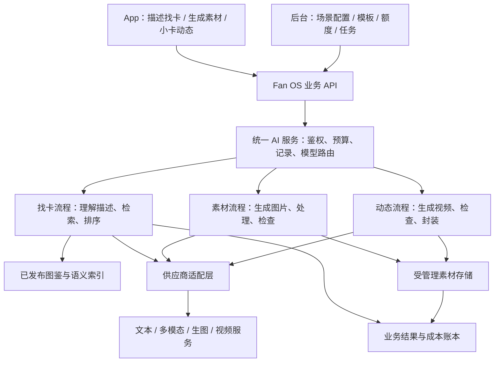

# Fan OS：AI 功能设计思路与后台统一接入方案

> 后续讨论已更新为[描述找卡与动态小卡详细方案 V0.2](FAN_OS_AI_CARD_SEARCH_LIVE_PRD_V0_2_20261026.md)，素材生成暂不纳入本期。本文件保留为三方向初稿。

| 文档属性 | 内容 |
| --- | --- |
| 版本 | V0.1 讨论稿 |
| 更新日期 | 2026-10-26 |
| 覆盖范围 | 相册素材生成、描述找小卡、小卡动态生成；App、后台、服务端、会员与成本 |
| 文档定位 | 在现有系统上提出产品与接入方案，供讨论后拆分 PRD；不是已开发或已上线功能清单 |
| 成本口径 | 延续此前基础云费用 ¥2,000/月、不计运营人力的讨论前提；新增 AI 调用及超出基础预算的存储、流量另算 |

## 1. 建议先确定的方向

建议采用“**后台统一管理 AI 能力，App 在具体业务场景里使用 AI**”的方式。首期把入口放在素材选择器、图鉴搜索、小卡详情，不必先做一个承接所有需求的通用聊天页。

三个场景共享账号权限、模型接入、额度、任务记录和成本统计，但使用不同的处理流程：

| 场景 | 用户得到什么 | 核心能力 | 建议优先级 |
| --- | --- | --- | --- |
| 描述找小卡 | 图鉴中真实存在、可点击的小卡候选列表 | 理解描述 + 图文检索 + 结果排序 | 第一优先，直接改善找卡效率 |
| 相册素材生成 | 能放进当前作品的背景、封面或贴纸 | 图片生成 + 场景适配 + 素材保存 | 第二优先，可与找卡并行做小规模验证 |
| 小卡“活过来” | 一张可播放的动态作品；支持的设备可导出 Live Photo | 图生视频 + 媒体处理 + 端侧保存适配 | 第三优先，先验证真人图输入、成品质量和成本 |

现有“卡片模式”和“相册模式”独立的产品口径继续保留；AI 根据所在模式和使用位置生成素材，不改变作品类型。素材管理也继续按书架、相册封面、相册内页、卡片背景分开。

## 2. 与现有系统的衔接

本轮依据本地代码和已有需求文档判断，不等同于生产环境验收。当前代码已实现 BOOK / CARDS 固定分离和四场景素材管理，较 10 月 22 日主 PRD 的部分“待开发”描述已有推进；本文以本轮核对的代码为现状。

| 现有基础 | 可以复用的部分 | 本次需要新增或验证 |
| --- | --- | --- |
| 数字相册与素材 | 两种模式固定分离、四场景管理、会员范围、受管理图片、作品草稿与公开版本、素材快照 | 生成任务、个人 AI 素材、生成来源追溯；当前图片背景只接受已上架官方素材引用，需增加私有素材使用规则 |
| 会员与取色 | NORMAL / PRO 权益判断、相册容量、取色额度及并发控制思路；取色为本地图片算法 | 搜索 / 图片 / 视频各自额度账本、预占与退回、供应商真实成本；现有扫描也未发现已接入次数配额 |
| AI 扫描 | 已发布图鉴、Card ID、图片版本、候选卡展示和用户确认 | 文字理解、跨模态向量、语义检索及搜索会话 |
| 后台图鉴索引 | 图片变化后的索引更新、异步事件及失败重试思路 | 语义索引及其独立版本、AI 生成任务调度，不能把视频任务塞入扫描索引队列 |
| 反馈与审核 | 对象关联、审核记录、通知、历史追溯的业务基础 | 生成内容审核、生成失败分类、结果投诉；与图鉴数据纠错分别处理 |
| 视频与导出 | 静态小卡展示、作品详情与 App 深链接分享 | 尚未发现视频 / Live 生成、播放和原生相册导出链路，需要新增 |

**扫描索引不能直接等同于语义搜索索引。** 当前扫描使用 SIFT 图像特征和 RANSAC 几何核验，适合辨认具体卡面；它没有直接提供“黑发、蓝背景、比耶”这样的文字检索能力。建议保留这条扫描路径，为描述找卡并行建立语义索引。[现有扫描说明](../apps/api/app/integrations/card_matcher/README.md)

## 3. 后台如何统一接入 AI

### 3.1 接入结构

建议先在现有后端中增加统一 AI 模块与独立任务执行进程，按量扩展；起步阶段无需部署一套庞大的独立 AI 平台。搜索短请求与图片 / 视频重任务分别设置队列、并发和预算，避免视频积压影响找卡体验。现有图鉴 Outbox 可借鉴用于可靠投递，但需新增生成任务记录与处理流程。

App 只向 Fan OS 提交业务请求，不持有供应商密钥，也不自行指定任意模型和费用参数。后台决定某个业务场景使用哪个经过验证的模型、规格和模板。

“统一接入”指共用管理和结算能力，不要求一个模型完成全部事情。文字理解、图片检索、生图和视频生成可以分别选择适合的服务。

### 3.2 后台建议新增的管理模块

| 模块 | 配置 / 展示内容 | 对业务的作用 |
| --- | --- | --- |
| AI 服务接入 | 供应商、地域、密钥引用、支持能力、调用限制、连接检查 | 密钥在服务端加密保存、脱敏显示，可轮换 |
| AI 场景配置 | 描述找卡、素材生成、动态小卡各自的开关、模型、规格、适用端和用户范围 | 可以单独停用视频，其他功能继续使用 |
| 模板与效果 | 素材风格、配色、留白、贴纸类型；动态幅度和效果；模板版本 | 用户选业务效果，后台把选择转成模型指令 |
| 额度与预算 | 免费体验、会员额度、加购包、并发数、日 / 月预算、单任务最高成本 | 控制权益和支出，提交前展示实际消耗 |
| 任务中心 | 请求、用户、场景、模型版本、任务状态、耗时、输出、失败原因、费用 | 排查失败、补偿用户、核对供应商账单 |
| 生成内容审核 | 待复核、通过、拒绝、申诉、公开状态、下架及影响作品 | 生成成功与允许公开分别管理 |
| 找卡索引与质量 | 索引覆盖率、陈旧索引、重建进度、搜索无结果、排序质量、用户反馈 | 让搜索持续变准，避免只管理提示词 |
| 用量与成本报表 | 各场景调用量、有效成品成本、失败成本、付费转化、素材应用率 | 判断功能是否值得放量 |

模型、模板、价格和权益规则均保留版本。用户发起任务时保存配置快照，运营之后修改设置不应改变该任务已确认的扣费。

模型切换先在测试集上验证并小流量发布。备用服务必须满足相同的输入政策、输出规格及预算；不能因主服务拒绝真人图，就自动换一个服务尝试绕过限制。

### 3.3 同一套基础记录，三种业务结果

建议至少保留以下逻辑记录，可按现有存储方式实现：

| 记录 | 关键内容 |
| --- | --- |
| AI 请求 | 用户、场景、请求幂等 ID、输入资源版本、模板版本、配置版本 |
| 执行尝试 | 供应商、模型、供应商任务 ID、开始 / 完成时间、状态、错误、实际费用 |
| 额度流水 | 额度来源、预占、确认扣减、退回、到期时间；与任务唯一关联 |
| 生成资产 | 所有者、原始来源、类型、适用场景、文件、缩略图、审核状态、公开范围 |
| 搜索会话 | 当前描述、已确认条件、候选 Card ID、索引版本、点击 / 是否找到 |
| 动态作品 | 来源 Card ID 与图片版本、封面、视频、导出资源、用户及公开状态 |

用户业务状态与供应商状态分开：供应商返回“成功”，仍可能需要下载结果、检查内容、封装和保存，不能马上显示“已完成”。额度预占和最终结算使用短事务，等待模型期间不持续持有用户或数据库锁。

## 4. 场景一：相册素材生成

### 4.1 App 入口与流程

在当前编辑器的素材选择器里增加“AI 生成”，自动带入作品类型、使用位置、画布比例和已有配色：

选择生成类型 → 选择风格 / 描述需求 → 预览规格与消耗 → 生成 → 查看结果 → 保存到个人素材 → 应用到当前作品。

示例：“给这本相册做一个淡紫色、银色星星的封面，中间留出放小卡的位置。”

用户可以只选择风格按钮，不必写复杂提示词；允许补充一句描述。起步建议一次生成 1 张，需要变化时明确点击“再生成一张”，再次展示消耗。可以用低成本模板示意展示风格，不能让用户误以为示意图是其付费生成结果。

### 4.2 按素材场景分别设计

| 场景 | 可以生成什么 | 对当前功能的影响 | 建议顺序 |
| --- | --- | --- | --- |
| 相册封面 | 背景、纹理、封面装饰 | 保留标题、小卡区域的可读性和留白，按封面比例生成 | 首批 |
| 相册内页 | 内页背景、边缘装饰 | 避免高对比图案干扰卡位；自动带入布局，但不改动卡位 | 背景先做；贴纸等候编辑器能力完成 |
| 卡片模式背景 | 舞台背景、氛围纹理 | 只用于卡片作品背景，不生成相册页面，不开启模式转换 | 首批 |
| 贴纸 | 单独装饰图、边框、徽章 | 需要透明通道检查、裁切和边缘质量检查；生成背景不等于透明贴纸 | 第二批 |
| 书架主题 | 主题底图或装饰元素 | 还需适配书架结构、文字和作品摆放；首期由运营制作并验证 | 后续 |

当前代码明确限制内页贴纸上架，第一批只接入已具备编辑和渲染能力的位置；内页贴纸需先补齐编辑器、保存与阅读链路。[素材类型校验](../apps/api/app/modules/albums/schemas.py)

不得把“生成图片”直接当作“生成一套可编辑相册”。图片模型输出的通常是图片资产；完整可编辑模板还需要布局、字体、卡位和装饰元素等结构数据，建议另立后续需求。

图鉴小卡保持原图引用。首期生成装饰和背景，不让模型重绘卡面、改变艺人形象或覆盖图鉴原图。中文标题优先由现有文字工具叠加，便于编辑，也减少生成错字。

### 4.3 平台生成与用户生成分开

| 类型 | 所有者 / 默认可见范围 | 如何进入素材库 |
| --- | --- | --- |
| 运营生成的候选素材 | 平台，默认草稿 | 在对应场景素材管理页生成，审核、配置 FREE / PRO 范围后发布 |
| 用户生成的个人素材 | 该用户，默认私有 | 进入“我的 AI 素材”；供本人作品使用，不自动变为官方素材 |
| 用户愿意推荐给平台的素材 | 保留原贡献者与生成来源 | 单独提交平台收录申请，通过后才进入公共素材库 |

后台四个素材业务页面分别增加“AI 生成”入口；统一任务中心只汇总执行记录，不把四类素材管理重新合并成一个大列表。

个人素材即使由 PRO 额度生成，也不应直接套用“官方 PRO 素材到期不能新增使用”的规则。建议已成功保存的个人生成资产在会员到期后仍可查看和用于本人作品；新生成任务按当前权益控制，作品容量仍按原相册规则校验。

公开作品引用个人素材时，只向有权访问该作品的用户提供必要的展示资源，不因此公开个人素材库、提示词和参考图。

### 4.4 必须补齐的产品细节

- 生成结果默认保存在个人生成记录中；“应用”需要用户确认，不自动覆盖当前背景。
- 退出 App 后任务继续，返回能恢复结果；后台生成排队不冻结编辑器。
- 生成贴纸时若模型不支持透明背景，需要增加去背景步骤和质量检查，成本单列。
- 作品引用资源 ID 和版本，保留快照；用户删掉素材库入口时，提示已被哪些作品使用，避免让旧作品突然空白。
- 生成文件保存至平台受管理存储，不直接把临时供应商链接存进作品。
- 机器检查与内容复核复用统一框架，但素材适配检查仍属于相册业务，例如比例、清晰度、遮挡和透明边缘。

## 5. 场景二：问答找小卡

### 5.1 产品形态

建议入口叫“描述找卡”，放在图鉴搜索和 AI 扫描入口附近。首页提供示例描述，结果以卡片列表为主，聊天只用于补充和调整条件。

示例交互：

> 用户：想找黑头发、蓝色背景、手在脸旁边比耶的那张卡。  
> App：先展示最接近的候选，提示可补充艺人、服装或来源。  
> 用户：是某组合的某位成员，穿白色衣服。  
> App：保留此前条件并缩小结果，显示真实小卡及图鉴信息。

第一次查询尽量先给候选，不先要求用户填完组合、艺人、专辑等字段。歧义会显著影响结果时，再问一个有用的问题。

### 5.2 检索怎样实现

建议分两步落地：

| 阶段 | 做法 | 适用价值 |
| --- | --- | --- |
| 基础版 | 发布图鉴时生成可检索的视觉描述，与名称、别名、来源、标签组合搜索 | 先覆盖明确特征，建立问题样本与搜索评测 |
| 增强版 | 加入可对齐文本和图片的多模态向量，再与结构化条件、关键词结果混合排序 | 处理自然语言、近义描述、模糊背景和动作 |

文字描述与图片可以通过多模态向量模型映射到同一语义空间，支持以文搜图；接入时必须使用匹配的模型版本、维度及图文编码方式。[阿里云多模态向量 API](https://help.aliyun.cn/zh/model-studio/multimodal-embedding-api-reference)

完整流程建议为：

1. 从描述里提取已确认条件：组合、艺人、来源、衣服、发色、姿势、背景、画面文字等；保留用户不确定的部分。
2. 明确指定的艺人 / 组合 / 来源等作为过滤条件；“好像”“可能”等作为排序偏好，不能误过滤目标。
3. 同时使用名称 / 别名关键词、可检索描述、图文相似度召回候选。
4. 只对少量候选做进一步比较，减少每次把全库图片送给模型的开销。
5. 服务端核对所有候选 Card ID、发布状态和图片版本，再返回图鉴卡片。
6. 展示匹配线索，如“蓝色背景、白色服装”；无法验证的特征不强行解释。
7. 用户补充条件后继续筛选，支持一键删除某个条件、重置会话。

“看起来相似”与“确定是这张”分开。相似度分数不直接展示成“98% 正确”；相近版本允许并列候选，由用户确认。

### 5.3 后台需要补的索引能力

每张可检索小卡至少关联：Card ID、图片版本、正式名称与别名、组合 / 艺人 / 来源 ID、视觉描述、关键词、向量及其模型版本、可检索状态。

视觉描述可以由模型预生成，但需标记为“机器检索辅助信息”，不自动改写正式图鉴资料。人物身份和发行信息以图鉴主数据为准，不能由模型看脸猜出来后写回。

图鉴新发布、换图、字段修订时增量更新；下架要立即从返回结果排除，即使旧向量尚未物理删除。模型更换时建立新版本索引，验证后切换，不能混用不对齐的向量。

首期可先采用现有数据库加关键词能力，再根据规模选择向量扩展或独立向量服务；选型由现有数据库、检索量与压测决定，不为了功能名称先增加多个数据库。

### 5.4 无结果与原功能衔接

| 情况 | App 处理 |
| --- | --- |
| 有相似候选 | 展示少量最佳候选，支持看更多、补充条件和“不是这张” |
| 条件可能过严 | 显示当前筛选条件，由用户决定放宽，不能偷偷取消明确条件 |
| 暂未找到 | 说明“暂未在图鉴中找到符合描述的小卡”，不等同于现实中不存在 |
| 用户手上有实物图片 | 引导使用 AI 扫描；扫描后确实缺失，再进入既有“小卡缺失反馈” |
| 找到卡但资料错误 | 打开该卡详情反馈，自动带入对象，走已有问题纠错 |
| 想加入相册 / 心愿单 | 用户点击确认后执行，模型不能自动修改收藏或作品 |

搜索只返回图库内真实记录，不用生图补出一张“可能存在”的卡。搜索记录归搜索会话，数据反馈仍进入统一反馈中心；不要把查找历史当作图鉴贡献。

## 6. 场景三：小卡“活过来”

### 6.1 先明确“1 张 Live 图”的含义

建议把用户看到的结果定义为“**1 件动态小卡作品**”，技术上包含静态封面、短视频和可选的系统相册导出资源。

| 层级 | 用户体验 | 研发边界 |
| --- | --- | --- |
| App 内动态小卡 | 列表显示封面和动态标识，详情点击或按住播放 | 可由封面 + 短视频实现，属于本功能核心交付 |
| 保存视频 | 导出短视频供分享 | 需要文件下载、系统保存和分享权限适配 |
| 保存为 iOS Live Photo | 在支持的系统相册中以实况照片使用 | 需要有效配对资源及元数据、编码处理与真机验证，不能把 MP4 改名交付 |
| Android 动态照片 | 根据机型及系统能力决定 | 先保证 App 内播放和视频导出，未验证机型不显示动态照片导出承诺 |

Apple 文档将 Live Photo 作为静态资源与视频资源组成的对象，并验证文件及元数据；其加载 API 不是把任意图片与视频自动合成为 Live Photo 的生成接口。因此，AI 视频生成与 Live Photo 封装要分别验证。[Apple PHLivePhoto 文档](https://developer.apple.com/documentation/photos/phlivephoto/request%28withresourcefileurls%3Aplaceholderimage%3Atargetsize%3Acontentmode%3Aresulthandler%3A%29?language=objc)

如果本功能上线时明确宣传“自动生成一张 Live 图”，应把目标设备上的封装和保存测试作为上线前条件；只完成视频时，入口应明确叫“生成动态小卡 / 视频”。

### 6.2 App 流程

小卡详情 → “让小卡动起来” → 选择轻动态效果 → 查看规格、消耗和适用说明 → 创建任务 → 等待 / 离开 → 收到结果 → 播放、保存或分享。

建议首期：

- 一次只处理一张满足接入条件的小卡，自动带入高质量原图和来源 Card ID。
- 默认轻微动作、单镜头、无声、保持原构图；如背景微动、轻风、轻微表情变化，最终可开放效果需实测确认。
- 目标成品约 3 秒，后台可按模型支持生成更长视频后裁切；实际按供应商生成时长计算费用，不能按截取后时长估算。
- 一次生成交付 1 件作品，不默认生成多份候选放大成本；用户主动重做算新任务。
- 输入图和输出仍标明“AI 生成动态效果”，不让用户误以为是真实拍摄视频。
- 先保存到“我的 AI 创作”；是否添加到相册作品另做明确操作。图鉴原图保持原样，动态作品不进入图鉴识别索引。

建议保留原小卡边框和文字，必要时将它们作为静态图层与生成的动态区域合成，减少文字变形；这属于额外处理能力，需连同裁切、主体边缘与画质测试，不能承诺仅凭提示词实现。

### 6.3 真人艺人图片是选型的前置验证项

这项功能对“是否能处理艺人小卡图片”的要求高于一般图片动效。图鉴中可展示一张图，不代表已获得送交外部模型生成衍生内容的许可；用户拥有实体卡也不能直接替代平台需要核实的使用范围。

例如，火山官方文档对所列 Seedance 2.0 / 2.5 系列说明了真人人脸参考输入限制，并另列授权素材等使用路径。应先以具体账号、模型、地域和已具备相应使用依据的样本确认可接入范围，再决定上架，不能仅看到“支持图生视频”就向所有小卡开放。[火山视频生成说明](https://docs.volcengine.com/docs/ark/video-generation-tutorial?lang=zh)

建议后台为图片增加独立的“允许 AI 衍生处理”状态及依据，与普通图鉴展示状态分开。不可用时显示清楚原因并不扣额度。没有可行的人像处理路径时，可以先提供基于原图的光效、粒子、景深等程序化动效，但需单独命名，不能冒充 AI 人物视频已实现。

### 6.4 视频成功后仍有后处理

图生视频 → 下载到受管理存储 → 技术与内容检查 → 裁切 / 去除音轨 / 尺寸适配 → 生成封面和播放版本 → 按目标设备封装 → 交付。

视频 API 通常需要异步创建、查询任务；阿里云的相关接口也返回任务 ID，结果链接有有效期，不能把临时链接当成永久作品地址。[阿里云图生视频 API](https://help.aliyun.com/zh/model-studio/legacy-image-to-video-api-reference/)

失败应区分：

| 失败点 | 产品处理 |
| --- | --- |
| 图片不符合处理条件 | 调用前拒绝，解释原因，不预扣最终额度 |
| 模型执行失败 | 任务失败，释放预占；供应商是否已收费记入平台成本 |
| 输出严重变形 / 质量不合格 | 标记不交付，按规则有限重试或退回额度，不能无限自动重做 |
| 视频成功但封装失败 | 保留视频，优先仅重试封装；若订单承诺 Live Photo，不能把视频当作完整成功结算 |
| 系统相册权限未授权 | 保留 App 内成品，允许后续再次保存；不重新调用模型 |
| 用户不喜欢但技术交付有效 | 提供反馈与明确的重做规则，不默认无限免费重生成 |

## 7. 统一任务体验与扣次规则

生成图片和视频建议都采用可恢复任务；找卡采用短请求 / 分阶段返回结果，避免三个场景共用一套漫长等待页面。

| 用户状态 | 说明 |
| --- | --- |
| 待开始 / 排队中 | 额度已预占，尚未开始模型执行；允许取消并退回 |
| 生成中 | 展示当前阶段，不伪造精确百分比；可离开页面 |
| 处理中 / 复核中 | 生成完成，尚未满足交付条件 |
| 已完成 | 结果已保存且满足本次承诺的交付规格 |
| 失败 / 已取消 | 展示原因与额度处理结果 |
| 状态待确认 | 网络超时但上游可能仍执行；继续查原任务，不立即再创建一笔 |

产品额度与真实费用分开管理：

1. 提交前展示“本次消耗 1 次图片生成”等具体单位，校验余额并原子预占。
2. 达到交付条件后确认扣减；系统失败或无法交付退回原额度来源。内部费用照实保留，用户退次不代表供应商退款。
3. 网络重试、App 重启、重复回调不重复扣次；每次外部尝试分别记录实际费用。
4. 执行状态未知时先查询与对账；不能为了“兜底”立即并发请求两个付费供应商。
5. 排队中可以取消；执行中若供应商不能取消，应展示真实状态，关闭页面不代表停止计费。
6. 成功交付后的再次下载、保存和应用不重新消耗生成次数；用户主动换风格重新生成需再次确认。
7. 找卡按一次有效分析计量；本次结果分页、点击候选和重试同一请求不重复计次。补充条件引起新的分析算新次，入口明确提示；正常未找到可计分析额度，系统错误退回。
8. 预占需有超时核对和释放机制；之后到达的迟到结果不得再次扣费或重复发放。

AI 创作记录承载素材和动态作品，搜索保留轻量历史；此前图鉴反馈的进度入口继续沿用，不把生成任务混入“我的贡献”。“我的贡献”仍只展示已收录小卡。

## 8. 对现有模块的影响

| 模块 | 必须考虑的变化 |
| --- | --- |
| App 图鉴 | 描述找卡入口、结果解释、条件调整、小卡动态入口；原扫描继续工作 |
| App 相册 | AI 素材入口、场景与画布自动带入、任务恢复、个人素材选择；模式固定规则继续执行 |
| 作品渲染 | 首期生成素材仍按静态资产使用；未来放入动态小卡需新增视频渲染和静态封面降级 |
| 作品导出 | 图片导出只能保留静态帧；动态导出需独立规格与能力，不能默认现有分享支持 |
| 主页 | 可新增独立 AI 创作入口；默认私有，公开分享需走审核，不扩大图鉴贡献 Tab |
| 后台素材 | 四个场景页面分别生成、审核、上架；个人素材和官方素材分开 |
| 图鉴发布 | 新增语义描述 / 向量更新；下架与换图同步影响查询返回 |
| 会员 | 加入搜索、图片、视频三类权益；已有容量与取色权益不被重复扣费 |
| 消息 | 生成完成、失败、审核结果通知，提供回到成品的入口 |
| 存储与性能 | 增加视频、封面、导出包和缓存；列表只加载静态封面，详情按需播放 |
| 审核 | 输入适用性、生成结果、作品公开、公共素材收录四个节点分别有状态 |
| 数据分析 | 记录搜索找到率、素材应用率、有效动态成品率及每个结果的实际成本 |

静态作品预览、公开版本、素材快照与到期保留机制继续生效。增加 AI 不应导致已有作品在模板更新、会员到期或生成任务失败后变样。

## 9. 内容、数据与权限设计

这里的重点是产品可用性与资源使用边界，具体上线要求需在选定服务和发行范围后补齐。

- 发送给模型的参考图需要满足该功能的使用条件；后台记录依据和适用范围，不把所有可浏览图鉴图自动视作可生成素材。
- 个人参考图、提示词和生成资产默认私有；不自动公开、不混入其他用户的候选素材，不用私人内容建立公共搜索索引。
- 供应商接入记录数据地域、保留期限、是否用于训练等合同或服务设置；未核实的项标记待确认。
- 生成内容保留来源和 AI 标识，导出不默默丢弃标识；拒绝公开的结果不能从公开 CDN 地址继续读取。
- 业务原文、图中文字、用户描述作为待处理数据，不能改变系统权限、额度或查询范围；模型输出必须通过服务端字段及 Card ID 校验。
- 公开前可结合自动检查和人工复核；公共官方素材由运营确认，用户私有生成不默认要求每件人工审批。
- 用户删除与资源保留分开：无引用生成草稿可按告知的期限清理；已被作品引用的资产按作品生命周期管理。单独设置原始大视频、播放版本、导出包的保留策略。
- 管理员可配置模型与预算；运营可管理模板、审核和查看任务；原始密钥和私人输入不因拥有运营后台账号而全部可见。

## 10. 模型与供应商选择思路

建议先用一家具备多种能力的主供应商降低接入量，同时保留适配接口。视频可以另选服务，不强制与问答或图片使用同一家。

| 能力 | 可以评估的官方接口方向 | 最重要的验证点 |
| --- | --- | --- |
| 描述理解 / 候选解释 | 主流中文文本或视觉理解模型 | 组合 / 艺人别名、模糊条件、多轮修正、结构化输出；不编造 Card ID |
| 图文检索 | 跨模态 embedding 服务 | 中文短语、姿势与服装细节、多语别名、版本对齐、存量建库费用 |
| 素材生成 | Seedream 等图片生成 / 编辑服务；也可评估万相图片能力 | 留白、风格一致性、比例、透明贴纸后处理、单张成品成本 |
| 图生视频 | 万相、Seedance 等提供官方 API 的系列 | 实际账号对艺人图片的适用条件、人物稳定性、无声设置、输出规格、可交付率 |
| Live Photo 封装 | 独立媒体处理与 iOS 适配 | 资源配对、系统相册保存、真机兼容、分享后的效果保留 |

火山图片生成接口提供文生图及参考图编辑等能力，不同模型支持的单图 / 组图等能力并不一致；模型能力表应按具体版本维护。[火山图片生成 API](https://console.volcengine.com/ark/region%3Acn-beijing/docs/image-generation-api)

万相新旧视频接口存在协议与能力差别，供应商适配层应显式绑定接口版本，不通过在后台只改一个模型名就假定兼容。[万相新版视频 API](https://help.aliyun.com/zh/model-studio/image-to-video-general-api-reference)

本稿没有执行付费生成或拿实际艺人卡做外部测试，也不把上述能力文档等同于 Fan OS 的接入许可、效果或成本保证。

## 11. 会员与成本怎么控制

### 11.1 权益建议

建议向用户展示“找卡次数、素材生成次数、动态生成次数”，后台再统一折算预算；首期避免所有功能用一个难解释的积分汇率。

| 功能 | 免费用户 | 会员 | 控制方式 |
| --- | --- | --- | --- |
| 普通图鉴搜索 | 保留免费 | 同左 | 不把原有搜索强制改成付费 AI |
| 描述找卡 | 少量体验或合理限频 | 更高额度 | 验证成本后尽量降低使用门槛 |
| 相册素材生成 | 少量一次性体验 | 每月少量生成额度 + 可加购 | 以实际输出张数计次，不能把一组 4 张算一张成本 |
| 动态小卡 | 限量活动体验 | 优惠购买或少量试用 | 建议按次包为主，不一开始承诺不限量 |
| 已生成资产 | 可查看、再次下载及使用 | 同左 | 到期限制新生成，不删除既有成品 |

具体次数在模型实测后写入会员主 PRD。此前 ¥15/月、¥128/年的方案只能作为讨论起点，不能直接附送大量视频生成。

### 11.2 在 ¥2,000 基础云预算上增加什么

月度技术支出建议分为：

**基础云 ¥2,000 + 搜索在线推理 + 图片生成 + 视频生成 + 新增存储 / 流量 / 转码 + 索引建设费用。**

索引首建、批量视觉描述、模型切换重建应作为一次性或阶段性投入单列。搜索每次只检索预建索引，不要每次扫描全库调用模型。

有效结果的单位成本需要包含失败与质量重试：

**单位有效成本 = 该场景全部尝试费用与处理费用 ÷ 可交付结果数。**

供应商按生成秒数收费、客户端只播放其中 3 秒时，预算仍按实际生成秒数记录。取消、内容拦截、未采用结果是否计费按供应商实际账单核对。

以下仅是便于讨论的可替换假设，不是供应商报价：

| 场景 | 月用量假设 | 单位有效成本假设 | 月支出 |
| --- | ---: | ---: | ---: |
| 描述找卡 | 10,000 次 | ¥0.01 / 次 | ¥100 |
| 素材生成 | 1,000 张 | ¥0.20 / 张 | ¥200 |
| 动态生成 | 300 件 | ¥1.00 / 件 | ¥300 |
| 额外存储、流量和转码 | — | 按月预留 | ¥100 |
| 新增合计 | — | — | ¥700 |
| 含基础云 | — | — | ¥2,700 |

上表单位成本已假定摊入失败和模型重试，不重复加同一费用；额外存储等单独计算。未包含一次性索引首建。若动态作品实际单位成本为 ¥3，其他假设不变，月技术支出升至 ¥3,300。

### 11.3 对此前会员盈亏讨论的影响

沿用原讨论假设：月卡 ¥15、年卡 ¥128，人数分别占 40% / 60%，渠道扣减 15%，退款准备 2%，单会员月均净收入约 **¥10.3292**。这些是情景参数，不是已核实的实际渠道费率。

**保本会员数 = 向上取整［（¥2,000 + 非会员 AI 补贴及其他固定增量）÷（¥10.3292 − 单会员月均 AI 增量成本）］。**

| 情景 | 单会员月均 AI 增量 | 每月固定 AI 补贴 / 增量 | 覆盖上述支出所需会员 |
| --- | ---: | ---: | ---: |
| 旧方案基线 | ¥0 | ¥0 | 194 人 |
| 轻量 AI 权益 | ¥1 | ¥300 | 247 人 |
| 中等 AI 权益 | ¥3 | ¥300 | 314 人 |
| 较多生成权益 | ¥6 | ¥300 | 532 人 |

分母小于等于 0 时，新增会员本身不足以覆盖其使用成本，提高用户体量也不能解决。这里仍未计算运营、人力、获客及税费，不应称为企业净利润。此表与上一用量表是两种独立测算视角，不能重复相加。

因此建议先给描述找卡和少量图片权益，视频另计或限量。控制的是“每位付费用户预计消耗多少”，而不仅是供应商标价。

## 12. 分期落地与验证

| 阶段 | 交付内容 | 放量前重点 |
| --- | --- | --- |
| 能力验证 | 用具备相应使用依据的样本比较找卡、生图、视频；验证 Live Photo 真机保存 | 人像接入可用、有效成品率、单位成本和导出兼容 |
| 最小统一底座 | 场景配置、服务端密钥、任务记录、额度预占 / 退回、预算上限 | 重复请求不重复收费；失败可追踪 |
| 第一批业务 | 描述找卡；相册封面和卡片背景生成 | 能找到真实卡；生成图能实际应用到作品 |
| 第二批业务 | 个人素材完善、透明贴纸、后台运营生成素材 | 私有 / 公共素材隔离，四场景使用校验 |
| 动态小卡试点 | 少量满足条件的小卡、轻动态模板、视频及目标设备 Live Photo | 人物稳定、封装成功、预算可控，再扩大可用范围 |

不预先承诺所有组合、艺人、所有机型都能使用动态功能。可用范围由图片处理条件和设备能力共同决定，后台配置并对用户解释。

建议建立独立的评测样本，至少覆盖：

- 描述找卡：同艺人近似卡面、别名、多语言、姿势、否定条件、模糊记忆、图库没有该卡；记录 Top 5 找到率、无结果误导率、用户最终确认率。
- 素材：各画布比例、标题留白、内页可读性、透明贴纸边缘；记录生成后实际保存 / 应用率。
- 动态：单人、多人物、遮挡、带字边框、不同画质；分别记录生成成功率、可用成品率和 Live Photo 保存率。
- 任务：超时、重试、重复回调、App 退出、余额不足、封装失败；费用账本与用户余额能够对上。
- 数据：图鉴下架后不再返回，私有素材不能被他人检索或下载，会员到期不丢已生成资产。

验收目标根据首轮测试设定，不能把模型供应商的演示效果当作 Fan OS 在真实小卡上的准确率。

## 13. 建议本轮讨论后锁定的默认方案

| 讨论点 | 本稿建议 |
| --- | --- |
| AI 入口 | 嵌入图鉴、相册、小卡详情；生成任务有统一“AI 创作记录” |
| 优先业务 | 描述找卡 + 封面 / 卡片背景生成；视频先试点 |
| 描述找卡结果 | 只返回图鉴中真实、可访问的小卡，支持追问和条件调整 |
| 素材归属 | 用户生成默认私有；运营生成经过审核再成为官方素材 |
| 素材管理 | 保留四个场景页面，分别增加生成入口 |
| 动态交付 | 1 件作品；App 内可播，目标 iOS 设备验证通过后才承诺 Live Photo |
| 动态内容 | 轻动作、无声、保留卡面和来源关联，不覆盖图鉴 |
| 会员 | 搜索较低门槛，图片少量包含，视频按次或限量 |
| 系统规模 | 现有后端增加模块与独立任务执行进程，按实际量再扩展服务 |
| 预算 | 基础云 ¥2,000 与新增 AI 支出分开；场景设预算、熔断和日限额 |

## 14. 关联文档与更新记录

- [相册功能主 PRD](FAN_OS_ALBUM_PRD_V1_1_20261022.md)：两种模式及四类素材场景的产品口径。
- [数字相册后台当前逻辑](ADMIN_DIGITAL_ALBUMS_CURRENT_PRD_20261020.md)与[P0 本地交付说明](ADMIN_DIGITAL_ALBUMS_P0_LOCAL_20261020.md)：素材、发布版本、权限及后续实现基线。
- [会员与云成本讨论稿](MEMBERSHIP_AND_CLOUD_BREAK_EVEN_20261014.md)：¥2,000 基础预算及会员情景参数。
- [扫描匹配实现说明](../apps/api/app/integrations/card_matcher/README.md)：现有扫描路径与语义检索差异。
- [相册素材校验](../apps/api/app/modules/albums/materials.py)与[相册权益服务](../apps/api/app/modules/albums/service.py)：素材使用与会员能力复用基础。
- [作品类型校验](../apps/api/app/modules/albums/work_types.py)、[四场景后台](../apps/admin/src/pages/digital-albums/MaterialScene.tsx)：当前模式分离及素材管理实现。
- [事务任务投递](../apps/api/app/common/events.py)、[图鉴任务执行](../apps/api/app/modules/admin/catalog_jobs.py)：已有异步处理基础，需另建通用 AI 任务流程。

本稿作为 AI 功能讨论稿独立维护；方案确认后，再将确定的权益、素材规则与场景交互同步至对应主 PRD。

| 版本 | 日期 | 更新 |
| --- | --- | --- |
| V0.1 | 2026-10-26 | 初版：三个场景的 App 体验、后台统一接入、异步任务、检索索引、Live 交付、成本影响及分期方案 |

