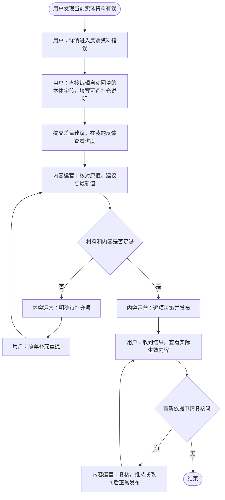

# Fan OS 纠正资料场景 PRD

| 属性 | 内容 |
| --- | --- |
| 版本 | V1.0 评审稿 |
| 日期 | 2026-10-28 |
| 主导角色 | 用户、内容运营 |
| 范围 | 已有实体本体资料纠错、补空白、说明问题、审核生效、撤回与复核 |

## 1 场景边界与角色

用户发现当前实体的资料有误，从该实体详情进入“资料有误”，打开“反馈资料错误”。内容运营在后台“反馈信息有误”受理，核对并处理。系统负责差量比较、校验、状态和通知，不作为第三个业务角色。

仅处理当前实体自身资料，不编辑其他实体列表。例如小卡绑定艺人错误，应到小卡详情修改所属艺人，不能在艺人页修改小卡列表。新增主体及内嵌缺失对象见[新增资料主 PRD](USER_FEEDBACK_PRD_V1_0_20261022.md)。

## 2 用户操作

### 页面与提交流程

1. 从详情“资料有误”进入“反馈资料错误”，锁定当前实体，不再要求选择对象。
2. 直接展示当前详情页全部本体资料字段的编辑态，自动填入最新正式值，不勾选字段、不逐项添加。
3. 用户修改需要调整的内容，底部仅保留一个可选“补充说明”多行文本框及提交按钮。
4. 客户端与服务端比较原值快照，仅提交实际变化字段；未变更字段不参与审核，不因整页回填而覆盖平台数据。
5. 提交后进入原反馈详情，按实际变更展示处理结果。编辑期间发现版本冲突则提示刷新核对，并保留用户输入。

字段按详情页现有业务顺序分组，包含头像、背景图、名称、个人基本资料及已有简介／历程／荣誉正文等本体字段；空白但已定义的字段也可补齐。日期、选择器、图片裁剪和长文本编辑复用现有控件。长文本内容是一个字段，不拆成逐条新增对象。

“单字段”指当前实体自身资料项，不局限于文本框。允许编辑当前实体自身已有归属选择，不展示专辑、小卡、成员、活动等关联实体列表，不展示其他实体的详细信息。Tag 等集合属性不作为本次新增纠错控件，沿用现有维护流程。内部 ID、状态、版权审核结果、统计值和系统时间不进入表单；衍生展示值通过原始业务字段更新。

不展示字段勾选、逐字段理由、SET／CLEAR／UNKNOWN 操作选项、独立链接／凭证表单或强制预览步骤。图片资料项自身仍支持更换图片；说明中可填写文字和来源链接。后台按既有快照和字段决策能力核查。

| 情况 | 规则 |
| --- | --- |
| 未修改任何字段 | 有补充说明可提交问题说明供人工核实；无说明则提示“请修改资料或填写补充说明” |
| 清空已有值 | 转换为清空建议，保留原值；原字段业务校验仍有效，正式发布前人工审核 |
| 可编辑字段缺失 | 扩展服务端字段配置，与详情本体公开字段一致，不能仅显示旧纠错白名单 |
| 字段数量与长度 | 沿用现有代码配置；当前通用接口最多 30 项，资料长文本沿用资料 PRD。超过接口限制需扩展原子提交能力，不要求用户手动拆单 |
| 字段变更 | 规范化后比较值；仅空格等无实质变化不生成虚假修改 |
| 部分采用 | 我的反馈展示实际生效字段和未采用原因；不因其他字段待审重发已完成修改 |

### 自动补齐策略

自动通过条件为字段白名单、最新值仍为空、格式与内容检测通过、关联有效、未触发异常限制。仅无违禁词不足以自动通过。

首版建议仅开放活动的城市／平台／场馆空白字段，并校验线上线下逻辑；介绍长文本、名称、日期、图片、卡片身份、来源、版本、人物归属、成员关系、Tag 和组合／艺人资料四板块均不自动生效。白名单默认关闭，具备配置权限的内容运营可逐对象与字段启用，记录变更审计。

自动处理产生与人工相同的正式变更记录，具有可撤回性；没有实质变化的提交标记“无需修改”，不生成虚假贡献。

## 3 内容运营操作

1. 在“反馈信息有误”按对象、阶段和是否待复核筛选申请，查看原值、用户建议、平台最新值及补充说明。
2. 核实图片、正文和自身归属，逐字段采纳、修改后采纳或不采用；保存内部草稿不通知用户。
3. 材料不足则明确缺失内容，退回原单补充；用户重提后重新核对当前版本。
4. 正式发布前检查字段与图片权限、关联、对象版本；失败回滚，保留操作输入并进入异常处理。
5. 成功后记录实际生效版本，向用户同步逐项结果和公开说明。未采用、部分采用必须说明原因。
6. 复核及已生效内容恢复同样检查最新版本，不覆盖后来修订。操作权限沿用现有代码，角色归为内容运营不表示所有运营账号自动取得发布权限。

## 4 撤回与复核

### 原单补充闭环

所有类型支持待补充原单重提，回填主对象、内嵌资料及原修改内容，保留反馈 ID 和每次提交快照。仅在待补充状态开放编辑；提交时检查 revision，重试幂等。运营明确缺失项，重提后回到待检查，由原处理菜单继续承接。本场景不进入新增投票。

### 用户撤回闭环

未正式生效的待检查、待补充、等待关联资料、投票中、人工处理中、审核通过待发布申请，可在详情选择“撤回反馈”。确认框说明停止审核／投票，已发布部分不会被删除；确认后服务端原子检查状态，关闭待处理任务和当前投票，记录撤回时间并更新列表。

撤回与发布并发时以服务端先完成的有效状态为准：若已发布则拒绝撤回，刷新实际结果并提供复核入口；不得显示撤回成功后继续自动发布。部分已生效时仅撤回未生效部分，结果保留“部分已采用，其余已撤回”。

撤回不删除材料和审计。用户可从原单“重新提交”，生成关联原单的新申请并重新预检，不能恢复旧票或重复计贡献。后台能够查看撤回原因及停止结果；已结束投票不再接受投票或改票。

### 用户复核闭环

已完成申请提供“申请复核”，填写必需复核说明，可补充新的依据；沿用现有材料能力，不要求重新填写原申请。服务端保存原结果和复核轮次，进入原所属菜单的“待复核”队列，并通知受理结果。同一原单最多一个处理中复核，重复点击幂等。

运营核对原材料、新依据、正式内容最新版本及历史决策，可退回补充、维持原结果或改判。维持需公开说明；改判后需要修改图鉴的，仍通过正常发布链路，成功后才显示复核已生效；失败保持“复核通过待发布”，进入异常重试。复核期间原已发布内容不自动下架，必要限制由授权人员另行执行。

复核结束通知用户，展示本轮理由、结果和最新图鉴入口。再次申请需有新增依据，同样内容重复复核返回上次结果；次数和冷却策略由后台规则配置。撤回未完成的复核只停止本轮，不撤销原审核结果。所有过程留痕，不直接恢复旧票或因申诉自动重新投票。

### 状态补充

“人工处理中”和“审核通过待发布”同样允许撤回尚未生效部分；已完成可申请复核。复核增加待复核、复核中、复核待补充、复核通过待发布、复核完成、复核已撤回子阶段，原工单结果保留，避免把复核受理误认为原结论已取消。

## 5 用户与内容运营协作流程

## 6 验收重点

- 进入即回填头像、背景及全部已定义本体资料，无字段勾选、逐字段理由、实体列表或强制预览。
- 只提交变化字段；没有变化但有说明可提交人工核实，无变化且无说明不能空提交。
- 切换或并发修改不覆盖他人数据；发布失败不误通知成功；部分采用逐项可见。
- 全类型原单待补充重提、撤回并发检查、复核受理到结果通知形成闭环。
- 小卡归属错误在小卡详情提交；纠错不创建新对象，也不触发新增投票。

接口限制、图片裁剪、权限、幂等和贡献规则沿用当前代码及主 PRD 公共约定；自动补齐默认关闭，字段启用须有规则与审计。
