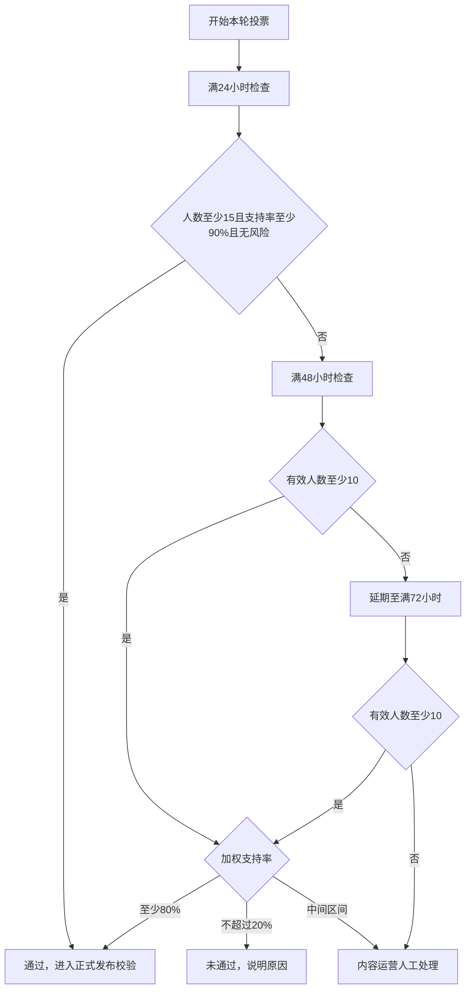
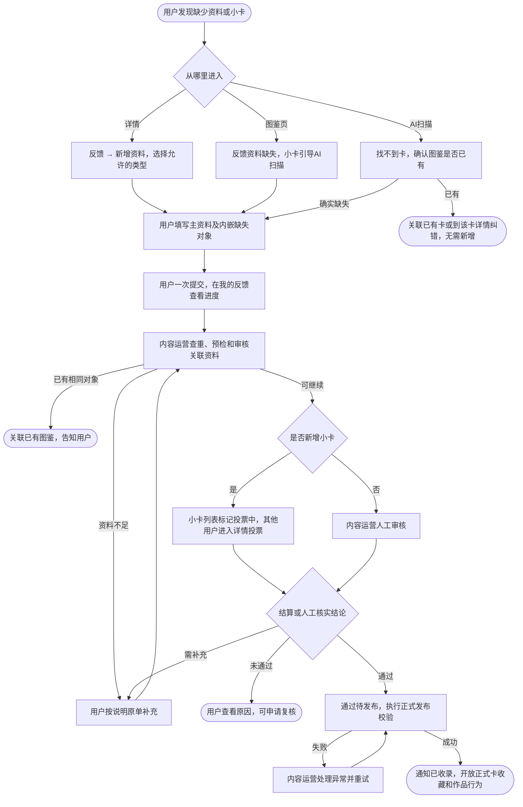

# Fan OS 新增资料与投票收录 PRD

版本：V1.5 评审稿｜更新：2026-10-28

以用户、内容运营两个角色说明新增资料从提交到收录的闭环。系统负责校验、计票、状态与通知，不另设业务角色。本文为目标需求，投票参数为试运行建议；未特别调整的字段、上传、权限与发布校验沿用当前代码。

已有实体资料纠错单独见[纠正资料场景 PRD](USER_FEEDBACK_CORRECTION_SCENARIO_V1_0_20261028.md)。

## 1 范围与角色

1. 用户作为提交者：发现缺失、填写资料、提交、补充、查看结果、撤回或申请复核。
2. 用户作为投票者：查看待收录小卡，支持或反对，可附带资料修订建议。
3. 内容运营：核实资料、处理重复与缺失关联、管理投票异常、审核发布及复核。实际操作权限沿用现有账号规则。

新增资料包含组合、艺人、专辑、版本、活动、其他来源和小卡。首版仅新增小卡进入投票，其余人工审核。除自制卡外，官方卡、平台官方卡等均可申请；自制卡边界由平台规则及案例说明。

## 2 用户提交新增资料

### 2.1 入口

详情页“资料有误”进入独立纠错场景；“新增资料”按下表提供类型，不增加关联列表反馈入口。

| 入口 | 可新增内容 |
| --- | --- |
| 艺人详情 → 新增资料 | 专辑、活动、其他、小卡 |
| 组合详情 → 新增资料 | 艺人、专辑、活动、其他、小卡 |
| 专辑详情 → 新增资料 | 版本、小卡 |
| 活动／其他详情 → 新增资料 | 小卡 |
| 小卡详情 | 仅资料有误，不提供新增 |
| 图鉴页下方 → 反馈资料缺失 | 组合、艺人、专辑、版本、活动、其他；小卡引导 AI 扫描 |
| AI 扫描单卡结果／详情 → 找不到卡／我要反馈 | 确认缺失后新增该小卡 |

个人页入口统一为“我的反馈”，用于跟进申请，不以“我的贡献”代替进度入口。

### 2.2 填写与提交

1. 带入当前详情或扫描单卡的有效资料，先搜索已有对象，避免重复新增。
2. 填写当前类型的新增表单，字段、必填与长度复用现有配置。专辑版本必须归属专辑；个人艺人可无组合，Other 不强制组合。
3. 缺少关联资料时，在当前表单展开对应对象填写。例如新增专辑选不到发行艺人，则内嵌填写艺人资料；版本缺专辑、小卡缺来源同理。
4. 主资料与内嵌资料一次提交，共用一个用户可跟进的主单。相同对象复用引用，禁止循环依赖；切换到已有对象时提示影响并清理失效关联。
5. 成功后在“我的反馈”查看进度；失败保留输入，重试不重复建单。登录后返回原页面，不自动提交。

已有对象只作关联，不在新增表单中直接修改它。组合新增已有艺人时核实成员关系，区分当前与历史成员；联合发行、参与关系沿用现有规则。

### 2.3 AI 扫描补卡

1. 针对当前检测卡搜索图鉴，确认是否已存在。
2. 已存在但未识别：关联正确卡，走现有识别反馈，不重复新增。
3. 已存在但资料或图片错误：进入该卡详情纠错。
4. 确实缺失：带入单卡裁剪图，填写新增资料；无有效检测结果时允许重新上传裁剪。

多卡扫描不混用其他卡片的图片与候选。原始扫描图为私有依据，投票只公开确认可展示的单卡材料。

## 3 用户参与投票与界面

### 3.1 列表与详情

1. 预检通过的待收录卡直接展示在现有小卡列表，明显标记“投票中”，沿用原筛选。不新建独立投票列表，不计入正式收录数量。
2. 进入详情查看正背面、人物、来源、版本、公开依据、当前轮次与剩余时间；允许放大图片。
3. 底部提供支持、反对、需要补充材料、跳过。支持与反对计有效票；需要材料与跳过不计支持率分母。
4. 支持或反对时，下方显示默认关闭的“补充或修正小卡信息”开关。反对、需要材料按原规则填写原因，其他原因需说明。
5. 确认成功后显示我的选择与时间；本轮截止前可修改。未登录先登录，发起人不可投本人申请；暂停或结束轮次不可投票。

结算前不公开支持率、他人个人选择和投票者名单；结算后可展示该轮人数、加权支持率及结论。私人凭证和内部备注不公开。

### 3.2 投票附带资料修订

1. 开启开关，直接展示小卡本体字段编辑态，默认回填发起人本轮资料，参考纠错界面：无字段勾选，不展示其他实体列表，底部可填补充说明。
2. 投票与建议一次提交，仅保存实际变化字段及原值快照；未修改也可正常投票，不增加票数。
3. 内容运营核实建议，不直接覆盖发起资料或正式图鉴。采纳解释等非身份变动后公示更新；采纳卡面、人物、来源、版本等关键变动则重开投票。
4. 改票回填本人选择与建议；关闭开关并确认则撤去当前建议。已经采纳的内容不自动恢复，审计保留。资料版本变化时要求重新核对。

### 3.3 待收录卡使用限制

正式发布前，禁止加入心愿单、标记已拥有、加入相册及其他作品使用。列表隐藏快捷操作，详情不展示相关按钮，服务端同时校验所有调用入口。

- 投票中／延期：显示投票中，可投票或改票。
- 暂停／待补充／争议或人数不足转人工：显示真实阶段，停止投票。
- 通过待发布：显示待收录，继续限制正式卡行为。
- 发布成功：转为正常卡，开放收藏与作品使用，不自动替用户执行。
- 未采用／撤回：移出公共小卡列表，原反馈及个人投票记录保留。

草稿不公开。待收录详情是申请视图，不提前创建可用于作品的正式卡；发布后映射正式卡，避免列表重复，旧详情可定位最终结果。

## 4 内容运营处理

### 4.1 两个菜单

1. **新增图鉴**：统一处理全部新增、内嵌对象、投票、发布异常和复核。
2. **反馈信息有误**：处理已有实体本体资料纠错，见独立文档。

原小卡缺失、图鉴缺失及纠错菜单的用户反馈业务归入这两个菜单，保留原记录与旧链接。纯识别质量问题沿用现有处理能力，不作为新增资料。

### 4.2 处理顺序

1. 按类型、入口、阶段和超时筛选，查看主资料、内嵌对象及依据。
2. 查重并核实归属。已存在则映射已有对象；不因入口来自某对象而忽略其他有效关系。
3. 材料不足，明确缺失项，退回原单补充。保存内部草稿不通知用户。
4. 按依赖顺序审核并发布内嵌对象。主对象未满足关联要求前保持等待；部分上游通过不等于整单收录。
5. 小卡满足预检后进入投票，其余人工审核。核查附带资料建议、风险证据及争议，必要时暂停或重开轮次。
6. 通过后按现有规则正式发布，成功才更新已收录、贡献与通知；失败进入异常待办，幂等重试。

上游已正式发布后，不因主申请失败或撤回而删除；仅本单使用且未发布的内嵌草稿随主单停止。发布前再次查重，避免并发申请创建重复卡。

### 4.3 异常与配置

保留投票时长、人数、支持率、等级权重、风险核查、超时提醒、复核频率及现有字段策略配置。每轮固定规则版本，调整不追溯旧轮。

异常待办覆盖人数不足、争议、上游阻塞、证据风险、发布失败。建议满24小时提醒运营；待补充满7天提醒用户，满30天按材料未补齐关闭并保留重提。参数可配置，不因此扣经验。配置、改判及暂停操作均留审计。

## 5 新增资料投票机制

### 5.1 预检与计票

进入投票前检查内容、图片、可识别资料、正式关联、重复及图片使用要求。缺失关联先审核内嵌对象，不能以支持率替代正式发布校验。

- 每轮每人一票，改票替换原票；支持改为需材料时，有效人数随之减少。
- 有效人数＝支持或反对的独立用户数。
- 加权支持率＝支持权重÷支持与反对总权重；分母为零不计算。
- 权重建议：Lv.1–3为1，Lv.4–7为1.5，Lv.8及以上为2。按投票时固定，不因后来升级变化；启用前按实际等级分布校准。

### 5.2 时间与结算

| 节点 | 条件与结果 |
| --- | --- |
| 满24小时 | 有效人数≥15、支持率≥90%、无待核查风险，可提前通过 |
| 满48小时 | 人数≥10：支持率≥80%通过，≤20%未通过，其余转人工；人数不足则延期 |
| 满72小时 | 人数≥10沿用上述比例；仍不足转人工，不认定用户反馈错误 |

需要材料建议达到3人且占非跳过参与人数30%时提醒运营检查，不直接驳回。普通反对只计票；有具体证据的重复、自制卡等风险由运营核查，期间暂停结算及投票，排除风险后补回暂停时长。

### 5.3 材料变化

- 补解释、来源凭证但身份不变：保留旧票，公示更新，允许改票。
- 更换卡面、人物、来源或版本：关闭旧轮，预检后开新轮并重新计时，旧票不继承。
- 转待补充：停止原轮，重提完成后重新检查并开完整新轮。
- 通过仍须正式发布；发布失败保留待发布，不误报已收录。

### 5.4 结算流程图

风险暂停优先于自动结算；所有时长从正式开启本轮投票计算，暂停时长不计入有效时长。

## 6 我的反馈、撤回与复核

### 6.1 进度与补充

“我的反馈”显示提交内容、内嵌对象结果、公开时间线、投票轮次及最终图鉴入口。可按类型、待处理、需我补充、投票中和已完成筛选。

阶段依次包括待检查、待补充／等待关联、投票或人工处理、通过待发布、已完成。结果区分已收录、部分采用、未采用、已有收录，不能把所有完成都叫已收录。所有新增类型支持原单回填补充重提，保留ID和历史，不要求重复录入主资料。

### 6.2 撤回

1. 未生效申请可在原单撤回，确认停止审核及投票；服务端原子检查与发布状态，防止撤回后继续自动发布。
2. 部分已生效仅撤回剩余部分，已正式发布的对象和贡献不自动删除；全部已生效则刷新结果并提供复核。
3. 撤回保留历史。重新提交创建关联原单的新申请，重新预检，不恢复旧票或重复计贡献。

### 6.3 复核

1. 完成后用户填写复核说明和新增依据，在原单申请；同一申请仅允许一个处理中复核。
2. 内容运营可退回补充、维持或改判，均有公开说明。原结果保留，受理不等于推翻原结论。
3. 改判需更新图鉴时走正常发布，成功后才显示复核生效；失败为复核通过待发布，进入异常重试。
4. 结束通知用户。撤回复核只停止本轮，原结果不变；相同依据重复申请返回上次结果，新依据与频率按配置处理。

## 7 两角色协作总流程

用户提交后无需停留等待；投票者附带修订建议按第3章核实，关键变更按第5章重开轮次。撤回与复核按第6章执行。

## 8 公共规则与验收

1. **一致性**：用户、运营及系统操作均校验最新版本、权限和幂等；发布失败回滚，通知失败独立重试。撤回、投票与结算并发按服务端状态裁定。
2. **通知**：待补充、最终结果、改判通知提交者；草稿静默，同一事件不重复通知。投票者通过原详情或个人记录跟进，不逐阶段群发。
3. **贡献**：仅真实采用用户图片且正式收录的小卡进入原有贡献逻辑，按卡去重；投票、文字建议不默认计贡献或奖励跟随多数。
4. **隐私**：私人工单仅本人可读，公开投票使用脱敏视图。内部备注、原始扫描图和私人凭证不能随申请公开。
5. **索引**：正式收录与识别索引更新分别处理；索引失败重试，不重复建卡，不提前宣称已可识别。
6. **验收**：入口类型准确；内嵌对象一次提交；支持／反对可选编辑且不直接覆盖；轮次与计票正确；待收录卡所有正式使用入口受限；发布后无重复卡；补充、撤回、复核及异常重试均可闭环。

## 9 依据与交付

本次交付涉及详情新增入口、主页缺失反馈、扫描补卡、小卡列表及投票详情、我的反馈、后台两个菜单和规则／异常待办。

- [纠正资料独立场景](USER_FEEDBACK_CORRECTION_SCENARIO_V1_0_20261028.md)
- [组合与艺人资料 PRD](CATALOG_GROUP_IDOL_PROFILE_PRD_V1_0_20261022.md)
- [反馈闭环实现说明](FEEDBACK_CLOSURE_FIX_20261020.md)
- 代码基线：`apps/mobile/lib/features/feedback/`、`features/scan/presentation/catalog_missing_feedback_page.dart`、`apps/api/app/modules/feedback/`、`apps/admin/src/pages/FeedbackWorkbench.tsx`。
